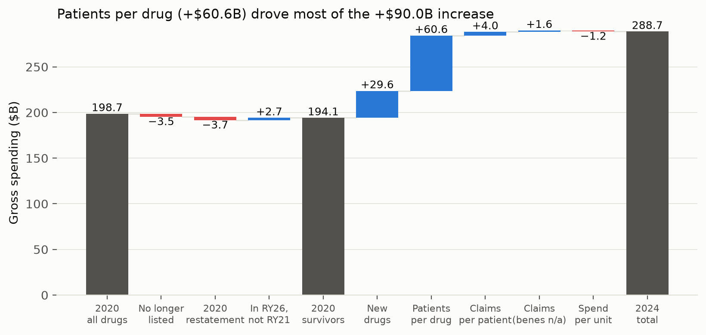
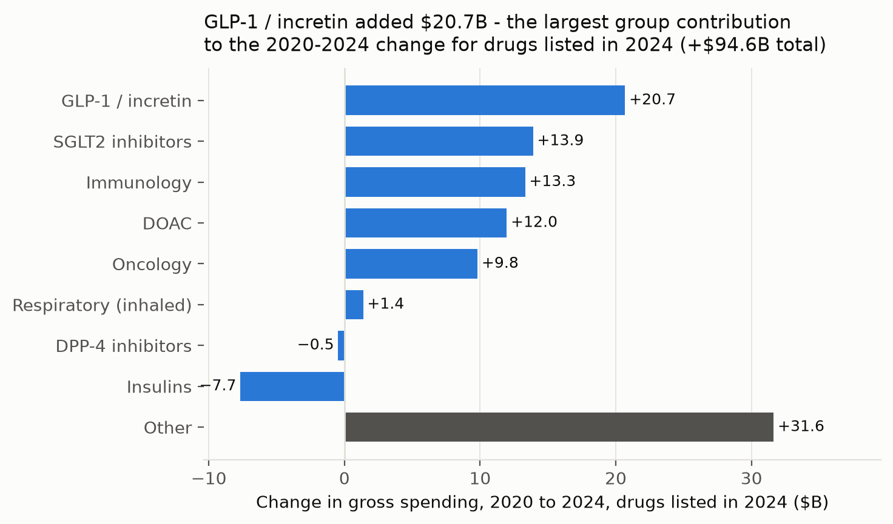
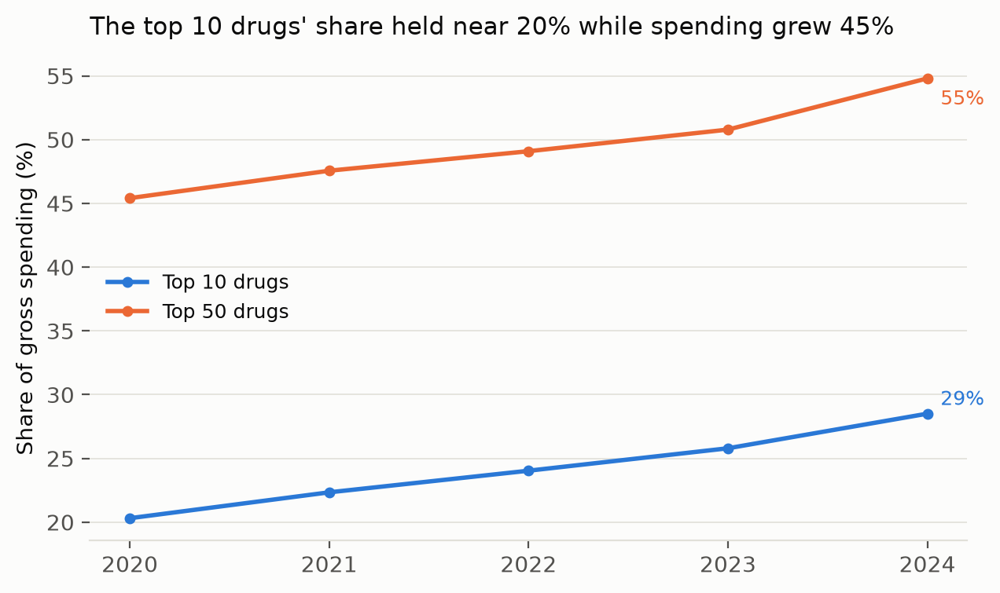

# Medicare Part D Drug Spending, 2020–2024

`SQL (DuckDB) · Python · pandas · matplotlib · Plotly · pytest · data quality checks · interactive dashboard`

Gross spending on Medicare Part D drugs grew from **$198.7B in 2020 to $288.7B in 2024** — a **+$90.0B (+45.3%)** increase on a full-market basis. This project decomposes that growth, drug by drug, into how much came from **more patients per drug**, **higher utilization**, **price**, and **newly listed drugs**, corrected for drugs that left the list — and it measures how exposed the total is to the CMS drug-price negotiation program.

## The problem

Headline Part D spending is a single number, but it is driven by very different forces: adoption of each drug, prescribing volume, list-price changes, and the churn of the drug list itself. A payer, policymaker, or portfolio owner needs the breakdown — and needs it to reconcile exactly, with the messy parts of the CMS file (suppressed counts, redacted cells, manufacturer rows that double-count, survivor bias) handled deliberately rather than silently.

## Results

All numbers below are produced by the pipeline in `results/` (a test enforces this — see *Tests*).

| Metric | Value |
|---|---|
| Gross spending 2020 (full market, RY21 release) | $198.7B |
| Gross spending 2020 (drugs still listed in 2024) | $194.1B |
| Gross spending 2024 | $288.7B |
| Change 2020→2024 | +$90.0B (+45.3%) |
| From more patients per drug | +$60.6B (67.3% of the change) |
| From new drugs on the list | +$29.6B (32.9%) |
| From utilization per patient | +$4.0B (4.4%) |
| From claims (patient count n/a) | +$1.6B (1.7%) |
| From gross spend per dosage unit | −$1.2B (−1.3%) |
| No longer listed (absent from RY26) | −$3.5B (−3.9%) |
| 2020 restatement between releases | −$3.7B (−4.1%) |
| In RY26 2020 but not RY21 | +$2.7B (+3.0%) |
| GLP-1/incretin spending growth | +$20.7B |
| 2026-negotiation drugs, 2024 spend | $61.2B (21.2% of total) |
| 2027-negotiation drugs, 2024 spend | $42.4B (14.7% of total) |
| Top-10 drugs' share of 2024 spending | 28.5% |
| Top-10 growth contributors' share of the increase | 62.7% |

**Findings**

- **Growth is mostly a patient-volume story, not a price story.** More patients per drug accounts for $60.6B of the $90.0B increase (67.3%) — this is adoption of each drug, *not* Part D enrollment growth (one person taking five drugs counts five times). Another $1.6B is claims growth on brands without a usable patient count. Gross spend per dosage unit contributed −$1.2B (−1.3%); that term mixes real price moves with changes in which strengths and forms were dispensed — the file has no list prices.
- **New drugs mattered far more than the whole price channel.** Drugs not on the 2020 list added $29.6B (32.9%) — an upper bound on truly new launches, since a brand under the 11-claim threshold in 2020 looks the same as a launch.
- **The survivor panel overstates growth.** Using only drugs still listed in 2024 gives +$94.6B (+48.7%). The full 2020 market is $4.6B larger: $3.5B of it was spent on 547 brand identifiers absent from RY26 (mostly exits or below-threshold drugs, but some are probable renames), $3.7B was restated away on shared brands, and $2.7B sits on 26 brands only RY26 reports for 2020 (22 share a generic name with an absent brand). Net: +$90.0B (+45.3%).
- **Spending is concentrating where negotiation will hit.** The top 10 drugs took 20.3% of spending in 2020 and 28.5% in 2024; just 10 drugs produced 62.7% of the increase; the 25 negotiated drugs hold 35.9% of 2024 spending ($103.6B).

<picture>
  <source media="(prefers-color-scheme: dark)" srcset="results/charts/decomposition_bridge_dark.png">
  
</picture>

<picture>
  <source media="(prefers-color-scheme: dark)" srcset="results/charts/group_growth_dark.png">
  
</picture>

<picture>
  <source media="(prefers-color-scheme: dark)" srcset="results/charts/concentration_dark.png">
  
</picture>

## How it works

`python -m src.run_all` runs the whole pipeline:

1. **Download** (`src/download.py`): fetches the RY26 CSV and the RY21 release if absent, verifies row counts and SHA-256, writes `data/raw/MANIFEST.json`.
2. **SQL** (`sql/01–09`, DuckDB): loads the raw files, runs quality checks, reshapes the wide year columns to long, assigns each brand a drug group, and produces totals, top-drug, group-growth, concentration, negotiation, and survivor-correction tables.
3. **Decomposition** (`src/decompose.py`): per-drug LMDI decomposition — `S = patients × claims/patient × units/claim × spend/unit` — exact to the cent, plus three survivor-correction steps from the prior release. Formula: `docs/metric_definitions.md`.
4. **Outputs** (`src/kpis.py`, `src/normalize.py`, `src/charts.py`, `src/build_dashboard.py`, `src/build_report.py`): `results/*.csv`, `results/kpis.json`, charts (light + dark), the `docs/index.html` dashboard, and `reports/management_report.md`.

## Data

- **Source:** CMS *Medicare Part D Spending by Drug*, RY26 release (2020–2024), released 2026-06-25, plus the RY21 release (2016–2020) for the unbiased 2020 baseline. Landing page: <https://data.cms.gov/summary-statistics-on-use-and-payments/medicare-medicaid-spending-by-drug/medicare-part-d-spending-by-drug>
- **Licence:** U.S. Government work, public domain (CMS Open Data).
- **Size:** 14,536 + 13,570 rows, ~5 MB each (checked in under `data/raw/`).
- **Caveats:** gross cost (excludes rebates — not net spending); each release lists only drugs with ≥11 claims in its final year, so the RY26 file is survivor-biased for 2020 (corrected via RY21); cells below the privacy threshold are redacted. Full detail: `docs/data_quality.md`.

## Reproduce

```bash
python -m venv .venv && .venv/bin/pip install -r requirements.txt   # Python 3.11+
python -m src.run_all          # downloads data if needed, writes results/, docs/index.html
```

Works on Linux and Windows (pathlib throughout; LF-only, rounded CSV/JSON output for byte-identical results across platforms). The dashboard is `docs/index.html` — open it directly, or it renders as GitHub Pages when pushed (`docs/.nojekyll` included).

## Tests

```bash
python -m pytest tests/ -q     # no network needed
```

Covers: decomposition exactness to the cent (unit + full-dataset), survivor correction on fixture and real data, hand-made fixture with known answers, no double-counting of manufacturer rows, all 25 negotiation selections matched, deterministic byte-identical results across runs, and key numbers in README/report/dashboard tracing to `results/` files.

## Repository layout

```
sql/                 DuckDB pipeline, run order 01–09 (each file has a header comment)
src/                 Python: run_all, download, db, decompose, kpis, normalize, charts, dashboard, report
data/raw/            the two CMS release files + MANIFEST.json (untouched by the pipeline)
data/reference/      drug_groups.csv (rule per row), negotiation_drugs.csv (source URL per row)
results/             every table, chart and KPI the pipeline produces
tests/               pytest suite + hand-made fixtures with known answers
docs/                index.html dashboard, decisions, metric definitions, data quality, walkthrough
reports/             one-page management report
```

## Limitations

- **Gross, not net:** CMS reports gross spending before rebates, so absolute levels overstate plan cost; trend and shares are the useful signal.
- **"Patients per drug" is not enrollment:** `Tot_Benes` counts users of each drug; summed over drugs it counts people multiple times. The factor is computed only for brands with a single disclosed row per year (188 brands fall back to claims growth because their patient count can't be trusted). It measures per-drug adoption, not Part D enrollment.
- **Baseline correction is aggregate:** `absent_from_ry26` is the 2020 spend of brands missing from RY26 (−$3.5B, 547 brands); `restatement_2020` is the net 2020 revision on brands present in both releases (−$3.7B, 940 brands); `ry26_only_2020` is 2020 spend RY26 reports for brands RY21 never listed (+$2.7B, 26 brands, 22 probable renames). The three sum exactly to the −$4.6B gap; per-brand detail is in `results/survivor_brand_reconciliation.csv`.
- **Units are not clinically comparable** across drugs (a pill ≠ a vial ≠ a pen), so spend-per-unit trends are per-drug, never across drugs — and even within a drug they mix real price moves with strength/form mix shifts.
- **Negotiation labels are by brand match** on the selected-drug name; exclusions are documented in `data/reference/negotiation_drugs.csv` and `docs/decisions.md`.
